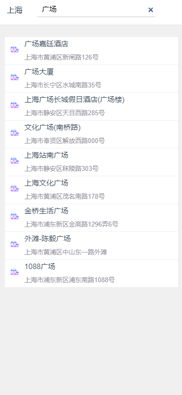
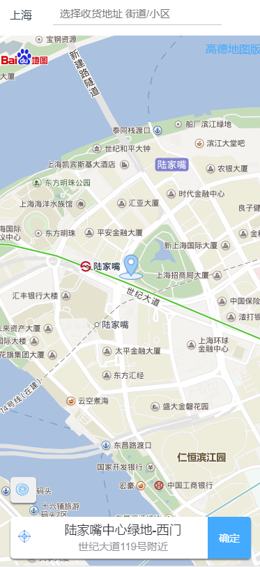
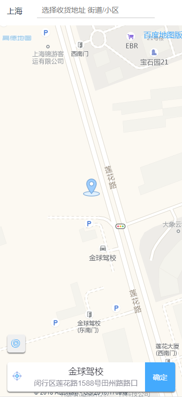

# Vue Map

基于 Vue 2 的百度地图和高德地图集成组件，提供完整的地图 POI 检索功能。

## ✨ 功能特性

- 🗺️ **双地图支持**：同时支持百度地图和高德地图
- 📍 **定位功能**：自动获取当前位置并在地图上显示
- 🔍 **拖动检索**：拖动地图自动检索当前位置的 POI 点
- ⌨️ **输入检索**：支持输入关键词搜索 POI 点
- 📱 **响应式设计**：适配移动端和桌面端
- 🎯 **地址选择**：提供完整的地址选择交互流程

## 📋 技术栈

- Vue 2.5.2
- Vue Router 3.0.1
- Webpack 3.6.0
- 百度地图 API v2.0
- 高德地图 API v1.4.5

## 🚀 快速开始

### 环境要求

- Node.js >= 6.0.0
- npm >= 3.0.0

### 安装依赖

```bash
npm install
```

### 开发运行

```bash
# 启动开发服务器（默认端口：8081）
npm run dev
# 或
npm start
```

### 生产构建

```bash
# 构建生产版本
npm run build

# 构建并查看打包分析报告
npm run build --report
```

## ⚙️ 配置说明

### 地图 API Key 配置

在使用前，需要在组件中配置对应的地图 API Key：

**百度地图** (`src/components/Bmap.vue`):
```javascript
loadingMap('baidu', 'YOUR_BAIDU_API_KEY')
```

**高德地图** (`src/components/Gmap.vue`):
```javascript
loadingMap('gaod', 'YOUR_AMAP_API_KEY')
```

> 💡 提示：请前往 [百度地图开放平台](https://lbsyun.baidu.com/) 和 [高德开放平台](https://lbs.amap.com/) 申请对应的 API Key。

## 📸 功能演示







## 📁 项目结构

```
vue-map-master/
├── src/
│   ├── components/
│   │   ├── Bmap.vue      # 百度地图组件
│   │   └── Gmap.vue      # 高德地图组件
│   ├── router/
│   │   └── index.js      # 路由配置
│   ├── utils/
│   │   └── load.js       # 地图 API 加载工具
│   └── main.js           # 入口文件
├── build/                # Webpack 构建配置
├── config/               # 项目配置文件
└── package.json
```

## 🎯 使用说明

1. **切换地图**：页面顶部提供地图切换链接，可在百度地图和高德地图之间切换
2. **定位功能**：点击右下角定位按钮，自动获取当前位置
3. **拖动检索**：拖动地图后，自动检索地图中心位置的 POI 点
4. **输入搜索**：在顶部搜索框输入关键词，显示匹配的 POI 列表
5. **选择地址**：点击 POI 列表项或确认按钮，完成地址选择

## 📝 开发说明

项目使用 Vue CLI 2.x 模板构建，如需了解更多构建细节，请参考：
- [Vue.js 官方文档](https://cn.vuejs.org/)
- [Vue Router 文档](https://router.vuejs.org/zh/)
- [Webpack 文档](https://webpack.js.org/)

## 📄 License

MIT


